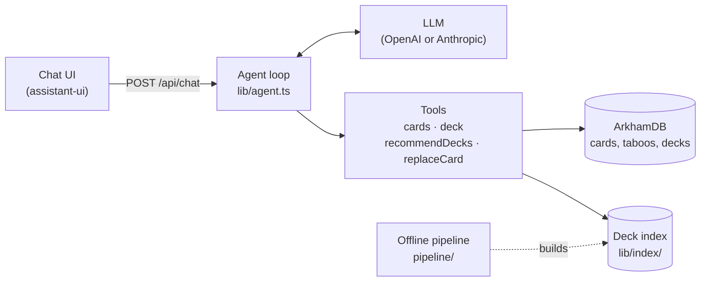

# arkham-ai

A chat assistant for two people playing *Arkham Horror: The Card Game* campaigns together. Ask
it about a rule, a card or a deck, and it answers from the real sources: the full Rules
Reference, ArkhamDB's card text with errata, official rulings and taboo changes, and any
published ArkhamDB deck with its author's guide. It can also find decks, and partners for a
deck, that the players can build from their own collection.

<p align="center">
  
  
</p>

## What it answers

| Question | How it answers |
|---|---|
| *Does doom on an enemy count toward the agenda?* | From the complete Rules Reference, which is part of the system prompt |
| *What does Ward of Protection do at each level?* | `cards` tool: every level and printing together, with errata and rulings |
| *How do I play Boom Chakra Lacka?* | `findDeck` finds the deck by its name, then the `deck` tool reads the decoded list and the author's guide live from ArkhamDB |
| *What could replace Archive of Conduits with something cheaper?* | `replaceCard` tool: legal, owned substitutes, with how often each is played |
| *Suggest a mystic cluever deck.* | `recommendDecks` tool: searches an index of 660 of the most-liked published decks by class, role, archetype, XP, investigator or key card |
| *What should I play with my partner's deck?* | `recommendDecks` with `pairWith`: decks whose role covers what the partner's deck lacks, never the same investigator |

Every card an answer names is a link. Tapping one opens the card in the app, laid out like the
printed card with its game symbols, art, owned printings, other levels and official rulings;
with the taboo list on, its taboo change too.

Decks are named the way players name them, never by number. A deck can be linked, named
("Boom Chakra Lacka", "the bless Mary deck", matched against the index; when the match is unsure
the assistant asks, and when nothing fits it asks for the link), or saved once under **Decks** as
yours or your partner's, so "my deck" is enough.

A few rules hold everywhere, enforced in code rather than left to the model:

- **Only owned cards.** Every recommendation and replacement can be built from the players'
  collection (`lib/collection.json`).
- **The taboo list is a switch.** When it is off, no taboo change is applied or mentioned. When
  it is on, the current list applies to card text, XP and deckbuilding.
- **XP is never a penalty.** A deck's XP cost is reported, but never counts against it in
  rankings.
- **Failures are reported as failures.** A lookup that fails says so; it is never presented as
  "there are none".
- **Text from ArkhamDB users is untrusted.** Deck names, guides and anything else a deck's author
  wrote are wrapped as data before the model reads them, so they cannot act as instructions.

## How it works



The app is a Next.js chat page and a single API route. Each question runs an agent loop
(the [AI SDK](https://ai-sdk.dev)'s `streamText`) with five tools. The system prompt holds the
whole Rules Reference (about 39,500 words) and never changes between requests, so the provider
can cache it. Anything that changes from turn to turn, such as the date and the players'
settings, is added to the newest message instead. Steps, tool calls and wall time are capped in
code, and the last step is always kept for the answer.

Card data, taboo lists and decks are fetched from ArkhamDB when needed. The one thing the app
builds ahead of time is its deck index: the ten most-liked published decks for each
investigator the players own. Each deck is labeled with a role, archetypes and a one-line summary.
Claude wrote the labels during development, one investigator at a time, and they were checked
against each deck's card counts. The offline pipeline that builds the index uses the same card
store, XP counting and legality check as the app, so the two can never disagree.

[docs/ARCHITECTURE.md](docs/ARCHITECTURE.md) walks through a request end to end.

## Getting started

You need Node.js 22.12 or later and an OpenAI or Anthropic API key.

```sh
npm install
cp .env.example .env.local   # then add your API key
npm run dev                  # http://localhost:3000
```

To try it without a key, run `ARKHAM_MODEL=mock:local npm run dev`. The mock model is a
scripted stand-in that sends each question to one tool, so the UI, the tools and the agent loop
can all be exercised for free. It doesn't write real answers.

The first request downloads ArkhamDB's card set (about 9 MB). The app keeps it for a day, in
memory and, in development, on disk under `data/cache/`.

### Configuration

All settings are environment variables, read from `.env.local` in development.

| Variable | Purpose |
|---|---|
| `OPENAI_API_KEY` | Uses OpenAI. When both keys are set, OpenAI is used. |
| `ANTHROPIC_API_KEY` | Uses Anthropic, when no OpenAI key is set. |
| `ARKHAM_MODEL` | Optional. Overrides the model as `provider:model`. The defaults are `openai:gpt-6-sol` and `anthropic:claude-opus-5-5`; `mock:local` is the mock model. |
| `ARKHAM_EFFORT` | Optional. Reasoning effort: `low`, `medium`, `high`, `xhigh` or `max`. Defaults to `medium` for OpenAI and `high` for Anthropic. |
| `NEXT_PUBLIC_ASSISTANT_BASE_URL` | Optional. An [Assistant Cloud](https://cloud.assistant-ui.com) project URL, which saves chats per browser and gives them titles. Without it, chats are kept in memory only. It is read at build time. |

For how the default model was chosen, see [docs/evals.md](docs/evals.md). For hosting it
privately on Vercel, see [docs/deploying.md](docs/deploying.md).

## Development

| Command | What it does |
|---|---|
| `npm run dev` | Starts the dev server |
| `npm run check` | Typecheck, Biome lint and format check, and the unit tests. CI runs this. |
| `npm run format` | Applies Biome's fixes and formatting |
| `npm run build` | Production build |
| `npm run e2e` | Builds the app and runs the Playwright tests in desktop and mobile Chrome |
| `npm run eval` | Runs the eval cases against a real model; this costs money |
| `npm run data:*` | Refreshes the data the app ships with; see [docs/data-pipeline.md](docs/data-pipeline.md) |

### Tests

The unit tests (Vitest) never touch the network. They read the same snapshots of the card set,
taboo lists and decklists that the index was built from (`tests/fixtures/`). They check
behavior against answers known in advance, for example:

- every level of a card comes back together;
- every suggested replacement is legal and owned;
- every indexed deck passes the legality check under its own taboo list;
- the index's XP totals match the `deck` tool's.

The system prompt and every tool definition are pinned in `tests/golden/`, since any change to
them changes what the model reads. After a deliberate change, regenerate the pins with
`UPDATE_GOLDEN=1 npx vitest run tests/golden.test.ts` and review the diff.

The end-to-end tests (Playwright) run the production build against the mock model and the same
snapshots, so they need no API key either. CI runs both suites on every push to `main` and on
every pull request.

### Evals

The evals (`evals/cases.ts`) are the product's use cases run against a real model, with a
spending cap. Each case writes a transcript to `evals/results/` (git-ignored) for a person to
read. The evals don't grade answers, but they flag card codes that no tool returned, taboo
mentions while the list is off, a deck called by its number, and empty answers.

```sh
set -a && . ./.env.local && set +a     # load the API keys into the shell
npm run eval -- --model openai:gpt-6-sol --max-usd 2 --cases rules-doom,partner
```

Omit `--cases` to run all of them. [docs/evals.md](docs/evals.md) has the results per model.

## Project structure

```
arkham-ai/
├── app/
│   ├── api/chat/route.ts   # POST /api/chat: validates and runs the agent
│   └── assistant.tsx       # the chat page
├── components/
│   ├── tools/              # how each tool's result renders in the chat
│   ├── settings/           # the taboo-list switch
│   ├── assistant-ui/       # thread and sidebar, adapted from assistant-ui
│   └── ui/                 # shadcn/ui primitives (vendored)
├── hooks/                  # client hooks: settings, chat title, media queries
├── lib/
│   ├── agent.ts            # the agent loop and its budgets
│   ├── prompt.ts           # system prompt, with the Rules Reference inlined
│   ├── model.ts            # picks the provider and model from the environment
│   ├── tools/              # cards, deck, recommendDecks, replaceCard
│   ├── cards.ts            # the card store, loaded from ArkhamDB
│   ├── legality.ts         # ArkhamDB's deckbuilding rules
│   ├── collection.json     # the packs the players own
│   └── index/              # the deck index and card play rates (generated)
├── pipeline/               # offline scripts that build the index and data
├── data/
│   ├── rules.md            # the Rules Reference
│   ├── faq.json            # official rulings
│   └── deck-labels/        # role, archetypes and summary of each indexed deck
├── tests/                  # unit tests; fixtures/ holds the data snapshots
├── e2e/                    # Playwright tests
├── evals/                  # eval cases and their runner
└── docs/
```

## Documentation

| Document | Covers |
|---|---|
| [ARCHITECTURE.md](docs/ARCHITECTURE.md) | How a request is answered, end to end |
| [design-decisions.md](docs/design-decisions.md) | Why it is built this way, and the alternatives that were rejected |
| [data-pipeline.md](docs/data-pipeline.md) | How the deck index is built, and how to refresh any data |
| [archetypes.md](docs/archetypes.md) | What each deck archetype means |
| [evals.md](docs/evals.md) | How answers were checked, per model, and what that changed |
| [deploying.md](docs/deploying.md) | Deploying to Vercel behind authentication |
| [design-log.md](docs/design-log.md) | The project's history: each version, what was measured, what was dropped |
| [AGENTS.md](AGENTS.md) | The invariants to keep when changing the code |

## Credits

This is an unofficial fan project. It is not affiliated with or endorsed by Fantasy Flight
Games or ArkhamDB.

- *Arkham Horror: The Card Game*, its card text, the Rules Reference (`data/rules.md`) and the
  official FAQ rulings (`data/faq.json`) are © Fantasy Flight Games.
- Card data, taboo lists, rulings and decklists come from [ArkhamDB](https://arkhamdb.com), a
  volunteer-run community site. The pipeline fetches at most one page every two seconds, and slows down further when the site is busy.
- The game-symbol font (`app/fonts/arkham-icons.woff`) and the card scans the card dialog shows
  are ArkhamDB's.
- Deck guides, and the decks themselves, belong to their authors. The assistant reads them live
  and links back to them.

## License

The code is released under the [MIT License](LICENSE). The license does not cover the
third-party material listed above: `data/rules.md`, `app/fonts/arkham-icons.woff`, `data/faq.json`, the deck index in
`lib/index/` (built from public decklists) and the ArkhamDB snapshots in `tests/fixtures/`.
